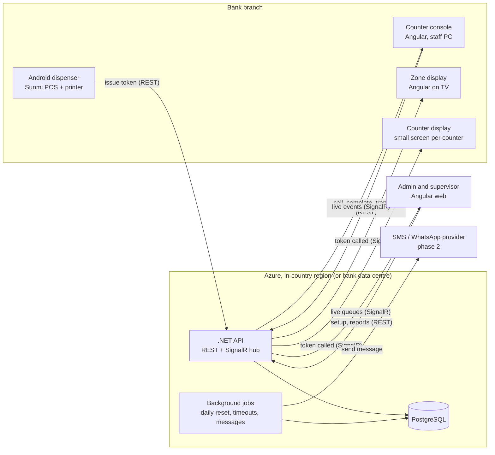
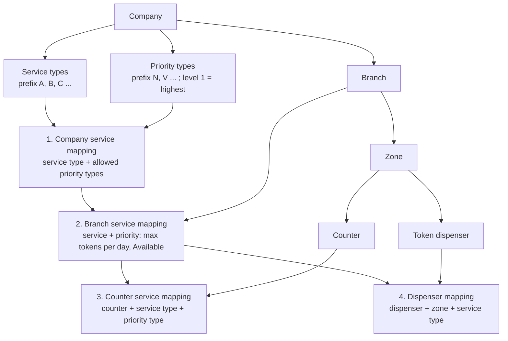
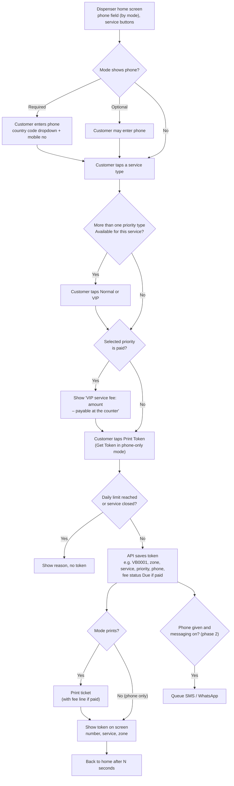
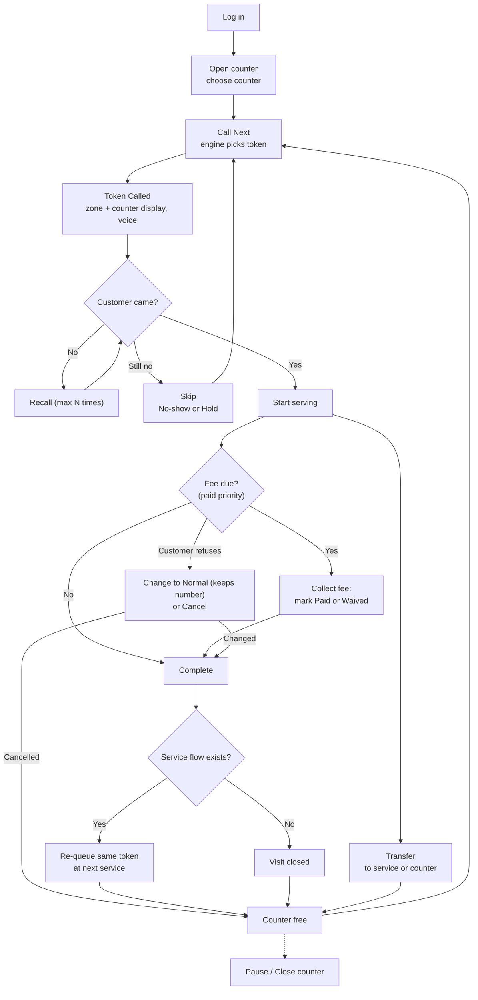
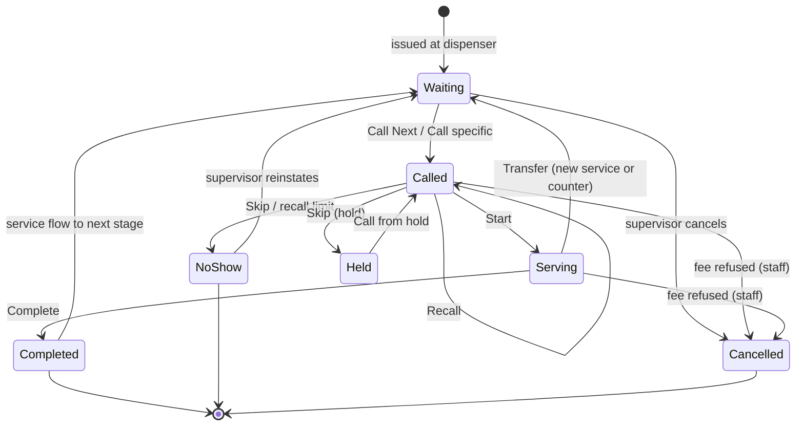
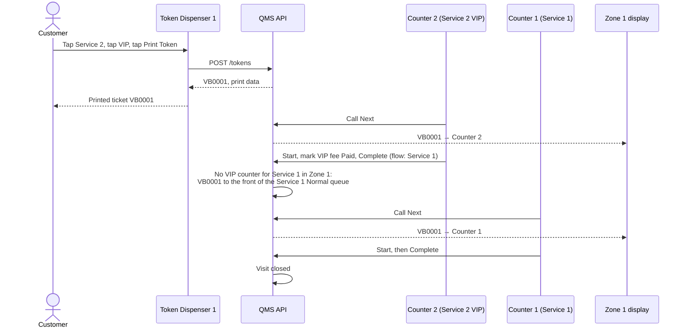

# Bank QMS – Project Specification

Nov 7, 2026 · @dev.webandapk

A multi-branch bank queue management system: .NET + PostgreSQL backend, Angular web app, Android token dispenser on Sunmi POS devices. Phase 1 uses printed tokens; phase 2 adds SMS and WhatsApp.

## 1. How to use this document with Claude Code

Export this document as Markdown, save it in the repository root as `docs/PROJECT_SPEC.md`, and ask Claude Code to build one milestone at a time (section 12).

- Workflow diagrams are written in Mermaid, so Claude Code reads them as text.
- Start each session with: *"Read docs/PROJECT\_SPEC.md. Build milestone M1 only. Follow the stack and rules exactly. Ask before changing the database schema."*
- Keep a short `CLAUDE.md` in the root pointing to this spec and listing the run, build and test commands.
- When a rule here changes, update this document first, then ask Claude Code to apply the change.

## 2. Development stack

Three applications share one backend: the .NET API with PostgreSQL, the Angular web app (admin, counter console, displays), and the Android dispenser app.

| Layer | Choice | Notes |
| --- | --- | --- |
| Backend framework | .NET 10 (LTS, SDK 10.0.x), ASP.NET Core 10 Web API, EF Core 10 | Clean architecture: Domain, Application, Infrastructure, Api |
| Database | PostgreSQL 16 or later | EF Core with Npgsql, code-first migrations, snake\_case names |
| Real-time | ASP.NET Core SignalR | Groups per branch, zone, counter and display |
| Auth | ASP.NET Core Identity + JWT (access + refresh tokens) | Devices use a device key, not a user login |
| Validation | FluentValidation | Every command and request DTO |
| Background jobs | Hosted services (`BackgroundService`); no Hangfire in phase 1 (ADR-005) | Daily token reset, no-show timeout, phase 2 message queue |
| Logging | Serilog to file and console | Correlation id per request |
| API docs | OpenAPI / Swagger | Versioned routes `/api/v1/...` |
| Testing | xUnit, FluentAssertions, Testcontainers for PostgreSQL | Queue engine fully unit-tested |
| Web frontend | Angular 22 (latest stable), TypeScript 6.0, Node.js 24 LTS; standalone components, signals | Angular Material (M3), themed from `docs/design/tokens.json` (ADR-001) |
| Web i18n | ngx-translate, Arabic and English, RTL switch | Language per user and per display |
| Web real-time | @microsoft/signalr client | Auto-reconnect |
| Display voice | Pre-recorded Arabic and English audio clips | Joined as "Token" + letters + digits + "counter" + number; more reliable than browser speech |
| Android app | Kotlin, Jetpack Compose, Retrofit + OkHttp | Kiosk (lock-task) mode, one activity |
| Printing | Sunmi built-in printer SDK | ESC/POS fallback for other printers |
| Hosting | Docker containers, HTTPS. First deployment: **Azure** (Container Apps, Azure Database for PostgreSQL Flexible Server, Key Vault, Container Registry), see ADR-006 | In-country Azure region; on-premise Docker (Nginx reverse proxy) stays supported |

Solution structure:

```
qms/
  backend/
    Qms.Domain/          entities, enums, domain rules
    Qms.Application/     use cases (commands/queries), queue engine, DTOs
    Qms.Infrastructure/  EF Core DbContext, migrations, repositories, SMS/WhatsApp adapters
    Qms.Api/             controllers, SignalR hubs, auth, middleware
    Qms.Tests/
  frontend/              Angular app (admin, counter, supervisor, display routes)
  android/               Kotlin dispenser app
  docs/PROJECT_SPEC.md
  docker-compose.yml     api + web + postgres
```

## 3. System architecture

All clients talk to one .NET API over HTTPS; screens that change live (counter console, displays, dashboard) also subscribe to SignalR.



### 3.1 Deployment

The first deployment runs on **Azure**, in a region inside the bank's country (ADR-006): API and web app as containers on Azure Container Apps, PostgreSQL on Azure Database for PostgreSQL Flexible Server, secrets in Key Vault, images in Azure Container Registry. Branch devices reach the API over HTTPS. The same containers run on the bank's own servers with Docker Compose.

### 3.2 Supported token dispenser devices

| Item | Value |
| --- | --- |
| Devices | Sunmi V2, V2 Pro, V2s and V3 handhelds; Sunmi T2s and K2 kiosks |
| Android | `minSdk` 25 (Android 7.1); `targetSdk` = latest stable Android API level |
| Printing | Sunmi built-in printer SDK; ESC/POS fallback for other printers |

## 4. Organization model and service mapping

Four mapping levels decide what a customer can pick and which counter serves it: company service mapping → branch service mapping → zone and counter mapping → dispenser mapping. Each level can only use what the level above allows.



| Entity | Meaning |
| --- | --- |
| Company | The bank (tenant). All data is filtered by company id. |
| Service type | What the customer comes for. Has a one-letter prefix (A, B, C ...). |
| Priority type | Customer class, e.g. Normal (prefix N, level 2) and VIP (prefix V, level 1). Lower level number is served first. A priority type can be **paid** (VIP fee, section 6). |
| Branch | A physical site. Owns zones, counters, devices, working hours. |
| Zone | An area of the branch where counters sit: a floor, a hall, or a section such as a Priority Banking area. A branch with one zone gets a default "Main zone". |
| Counter | A desk in a zone, staffed by one user at a time. |
| Queue | One per branch + zone + service type + priority type. Tokens wait here. |
| Service flow | Optional next service after one completes (e.g. Customer Service → Teller). |
| Device | A registered token dispenser, zone display or counter display. |

### 4.1 Company service mapping

The company defines its service types and which priority types each service allows.

| Company | Service type | Service prefix | Priority type | Priority prefix | Priority level |
| --- | --- | --- | --- | --- | --- |
| Company 1 | Service 1 | A | Normal | N | 2 |
| Company 1 | Service 2 | B | Normal | N | 2 |
| Company 1 | Service 2 | B | VIP | V | 1 |
| Company 1 | Service 3 | C | Normal | N | 2 |
| Company 1 | Service 3 | C | VIP | V | 1 |
| Company 1 | Service 4 | D | Normal | N | 2 |
| Company 1 | Service 5 | F | Normal | N | 2 |
| Company 1 | Service 6 | G | Normal | N | 2 |

Priority types of Company 1 (seed data; currency of Company 1 is AED):

| Priority type | Prefix | Level | Paid | Fee |
| --- | --- | --- | --- | --- |
| Normal | N | 2 | No | — |
| VIP | V | 1 | Yes | 50.00 (example; set by the company admin) |

The company mapping defines which priority types a service **can** have; the branch service mapping (4.2) decides per branch whether each pair is Available. A branch without VIP service sets all its VIP pairs to Not Available.

### 4.2 Branch service mapping

Each branch picks service + priority pairs from the company list, with a daily token limit and an on/off status.

| Branch | Service type | Priority type | Max tokens per day | Status |
| --- | --- | --- | --- | --- |
| Branch 1 | Service 1 | Normal | 100 | Available |
| Branch 1 | Service 2 | Normal | 100 | Available |
| Branch 1 | Service 2 | VIP | 100 | Available |
| Branch 1 | Service 3 | Normal | 100 | Available |
| Branch 1 | Service 3 | VIP | 100 | Available |
| Branch 1 | Service 4 | Normal | 100 | Available |
| Branch 1 | Service 5 | Normal | 100 | Available |

"Not Available" hides that pair from every dispenser in the branch; existing waiting tokens are still served.

### 4.3 Zone, counter creation and service mapping

Counters are created inside a zone and mapped to service + priority pairs that the branch offers.

| Branch | Zone | Counter | Service type | Priority type |
| --- | --- | --- | --- | --- |
| Branch 1 | Zone 1 | Counter 1 | Service 1 | Normal |
| Branch 1 | Zone 1 | Counter 1 | Service 2 | Normal |
| Branch 1 | Zone 1 | Counter 1 | Service 3 | Normal |
| Branch 1 | Zone 1 | Counter 2 | Service 2 | VIP |
| Branch 1 | Zone 1 | Counter 2 | Service 3 | VIP |
| Branch 1 | Zone 2 | Counter 3 | Service 4 | Normal |
| Branch 1 | Zone 2 | Counter 4 | Service 5 | Normal |

Counter 2 serves the VIP pairs of Service 2 and Service 3, both in the company mapping (4.1) and the branch mapping (4.2). A counter **may** be mapped to a branch pair that is Not Available: it still serves tokens already waiting, and dispensers hide the pair. A counter row whose pair is missing from the branch mapping is rejected.

### 4.4 Dispenser zone and service mapping

Each dispenser lists the zone + service pairs it issues tokens for; one dispenser can cover several zones.

| Branch | Dispenser | Zone | Service type |
| --- | --- | --- | --- |
| Branch 1 | Token Dispenser 1 | Zone 1 | Service 1 |
| Branch 1 | Token Dispenser 1 | Zone 1 | Service 2 |
| Branch 1 | Token Dispenser 2 | Zone 1 | Service 3 |
| Branch 1 | Token Dispenser 2 | Zone 2 | Service 4 |
| Branch 1 | Token Dispenser 2 | Zone 2 | Service 5 |

The priority buttons on a dispenser come from the branch service mapping for the chosen service, not from the dispenser mapping.

**Validation rules (enforced by the API):**

- Branch row → the service + priority pair must exist in the company mapping.
- Counter row → the pair must exist in the branch mapping (Available or Not Available); a pair missing from the branch mapping is rejected.
- Dispenser row → the zone must have at least one counter mapped to that service, otherwise save with a warning "no counter serves this service in this zone".

## 5. Confirmed workflows

Five workflows define the system; build and test against them.

### 5.1 Admin setup

Steps 1–3 once per company; steps 4–10 for each branch. The order follows the mapping levels in section 4.

```mermaid
flowchart LR
  S1["1. Company<br/>Super Admin"] --> S2["2. Service types<br/>and priority types (paid, fee)"] --> S3["3. Company<br/>service mapping"] --> S4["4. Branch<br/>hours, holidays, fee override"] --> S5["5. Branch service mapping<br/>max per day, Available"]
  S5 --> S6["6. Zones<br/>and counters"] --> S7["7. Counter service mapping<br/>service + priority"] --> S8["8. Dispensers<br/>zone + service mapping, mode"] --> S9["9. Displays<br/>zone and counter"] --> S10["10. Staff users<br/>roles, counters"] --> GL(["Go live"])
```



### 5.2 Token generation at the dispenser

The customer does everything on one screen: phone number (if the mode shows it), service, priority, then Print Token. The token is saved before printing or messaging, so a printer or message failure never loses a token.



### 5.3 Counter staff operation



### 5.4 Token lifecycle



### 5.5 Multi-stage visit (example: Service 2 → Service 1)

The token keeps its number across stages; each stage is one `token_visit` row.



Counter 1 maps only Service 1 Normal and no counter in Zone 1 serves Service 1 VIP, so VB0001 joins the **front** of the Service 1 Normal queue, keeps its number and is served as Normal there. No new fee is charged (section 6, Service flow).

## 6. Business rules

These rules belong in `Qms.Application` (queue engine) and must be covered by unit tests.

**Token numbering**

- Format: `[Priority prefix][Service prefix][4-digit sequence]`, no separators. Example: VIP + Service 2 = `VB0001`; Normal + Service 1 = `NA0001`.
- Sequence per branch + business date + priority type + service type: every priority + service pair has its own sequence. `NB0001` (Normal + Service B) and `VB0001` (VIP + Service B) both exist the same day.
- 4 digits allow 9999 tokens per sequence per day; the daily limit in the branch service mapping stops issue earlier.
- Reset daily at branch opening time (background job), or on the first token of a new business date.
- The number never changes when the token moves to another stage or is transferred.
- Generation must be safe under concurrent requests: row lock on `token_sequence` for that branch + date + priority + service.

**Issue rules (dispenser)**

1. The service must be in the dispenser mapping; the zone comes from that mapping row.
2. The service + priority pair must be Available in the branch service mapping.
3. If the service has only one Available priority type, the dispenser skips the priority choice and uses it.
4. Tokens issued today for that pair must be below Max tokens per day; otherwise "Service full for today".
5. The branch must be open (working hours, holidays, special hours).
6. If the priority type is paid, the token is saved with fee status **Due** and the fee amount at issue time (branch override, else the company fee); the response and the print data include the fee line.

**Call Next (queue selection)**

1. Collect the counter's mapped service + priority pairs, in the counter's zone.
2. From Waiting tokens matching those pairs, pick the lowest priority level first (VIP level 1 before Normal level 2).
3. Within the same level, pick tokens placed at the front first (`is_front`: priority transfer, or a VIP token forwarded into a Normal queue), then the earliest `queued_at`, across all mapped services.
4. Lock the token (`SELECT ... FOR UPDATE SKIP LOCKED`) so two counters never call the same token.
5. Set status Called, write `called_at`, push SignalR events.

A counter only serves the priority types it is mapped to: in the example, Counter 1 never calls VIP tokens and Counter 2 never calls Normal tokens.

**Other counter actions**

- **Call specific token:** staff may call a Waiting or Held token by number, if it matches their counter's mapping.
- **Recall:** re-announce; allowed up to the branch setting (default 3).
- **Skip:** after recall limit or by staff choice. Branch setting decides the default: No-show (closed) or Hold (kept aside, can be called later). Supervisor can reinstate a No-show to Waiting.
- **Start / Complete:** writes `started_at` / `ended_at` on the current `token_visit`.
- **Transfer:** to another service (back of that queue by default, or front if staff tick "priority transfer") or to a specific counter; optional note shown to the next staff member. The token keeps its priority type.
- A counter serves one token at a time. Pause is allowed only with no token in progress.

**Paid priority (VIP fee)**

- A priority type can be paid (`is_paid`) with a fee amount per company, optionally overridden per branch. Phase 1 has no payment on the dispenser: the fee is payable at the counter.
- Dispenser: when a paid priority is selected, show "VIP service fee: <amount> – payable at the counter" before printing; the ticket prints the fee line.
- Counter console: a token with fee status Due shows a "Fee to collect" badge. Staff mark it **Paid** or **Waived** (stored on the token with user and time) before **Complete**; Complete is rejected while the fee is Due.
- If the customer refuses to pay, staff either **change the priority to Normal** (the token keeps its number, e.g. `VB0001`; fee status becomes None; written to `audit_log`) or **cancel** the token.
- Staff-issued VIP tokens (`/counter/issue`) follow the same fee rules.
- The fee is charged once per visit: later stages (service flow, transfer) never add a fee.
- Card or online payment on the dispenser is a later phase.

**Service flow**

- Each flow has a mode: **Auto** (always re-queue at next service on Complete), **Ask** (counter sees "Complete" and "Complete & send to X"), or **None**.
- A forwarded token joins the next queue ordered by forward time and keeps its priority type.
- If no counter in the zone is mapped to the next service with the token's priority type (e.g. a VIP token forwarded to Service 1, which only has Normal counters), the token joins the **front** of that service's Normal queue, keeps its number (e.g. `VB0001`) and is served as Normal at that stage. No new fee is charged.

**Zones**

- A queue is branch + zone + service + priority, so one service can run in two zones.
- A dispenser issues tokens only for its mapped zone + service pairs; the ticket and confirmation screen show the zone name.
- Each zone display shows calls for counters in its zone; an optional lobby display shows all zones.

**Working hours**

- Dispenser blocks issue outside branch hours, on holidays, and for services with no Open counter in that zone (configurable: allow anyway, or block).
- Ramadan or special hours are date-range overrides on the branch calendar.

## 7. Token dispenser (Android app)

Each dispenser is configured from the web admin; the app holds no business rules and only shows what the API returns.

| Token mode | Phone number | Printed ticket | SMS / WhatsApp | Phase |
| --- | --- | --- | --- | --- |
| PrintOnly | Hidden | Yes | No | 1 |
| PrintPhoneOptional | Shown, optional | Yes | If phone entered | 1 (messages in 2) |
| PrintPhoneRequired | Shown, required | Yes | Yes | 1 (messages in 2) |
| PhoneOnly | Shown, required | No | Yes | 2 |

**Dispenser screen (one screen)**

Layout for Token Dispenser 1 in the example; Dispenser 2 is the same with Service 3, 4 and 5.

```
+---------------------------------------------------+
|  [Bank logo]                 [English | العربية]  |
|                                                   |
|  Phone No (Optional):  [+971 v] [ Mobile No     ] |
|                                                   |
|  Service type:                                    |
|     [  Service 1  ]        [  Service 2  ]        |
|                                                   |
|  Priority type:                                   |
|     [  Normal  ]           [ ★ VIP   ]            |
|  VIP service fee: AED 50.00 – payable at counter  |
|                                                   |
|             [        PRINT TOKEN        ]         |
+---------------------------------------------------+
```

- **Phone row:** shown by mode; label "(Optional)" or "(Required)"; country code dropdown (default +971, list set per company), numeric keypad.
- **Service type buttons:** from the dispenser mapping, grouped by zone when the dispenser covers more than one zone; a full or closed service is greyed out with the reason.
- **Priority type buttons:** only the priority types Available for the selected service in the branch mapping (and VIP only when "Show VIP" is on). With only one (e.g. Service 1 Normal only), the row is hidden and that priority is used. Default selection is Normal.
- **Fee notice:** when the selected priority is paid, show "VIP service fee: <amount> – payable at the counter" above the Print Token button.
- **Print Token button:** enabled once a service (and priority, when shown) is selected and a required phone is valid. Label "Get Token" in phone-only mode.
- **Confirmation:** large token number (e.g. `VB0001`), service, zone, people ahead, fee line when paid; returns home after N seconds (default 8).

**Settings per dispenser** (inherit company default → branch default → dispenser):

- Branch, installed zone, zone + service mapping (section 4.4), button order.
- Token mode; country code list and default; min/max digits; consent text.
- Languages: Arabic, English, or both with a toggle; default language.
- Ticket template: logo, header and footer (Arabic + English), large token number, service, zone, people ahead, estimated wait, date and time, fee line for a paid priority ("VIP service fee: AED 50.00 – payable at the counter").
- Confirmation seconds; idle banner image.
- Show VIP on the dispenser: **yes (default)** / no. When no, VIP tokens are issued only by staff from `/counter/issue`. Staff can issue VIP tokens either way.

**App behaviour**

1. **First start:** admin enters the server URL and a one-time registration code generated in the web admin; the API returns a device key stored in encrypted storage.
2. **Start-up:** load settings, services and priorities (`GET /api/v1/device/config`); refresh on SignalR `DeviceConfigChanged` and every 5 minutes.
3. **Print Token:** `POST /api/v1/tokens`; on success print (if mode prints) and show confirmation.
4. **Errors:** no network → "Out of service, please ask staff"; printer error (paper out, cover open) → no token issued in print modes, alert to supervisor via `POST /api/v1/device/status`.
5. **Heartbeat** every 60 seconds with printer status; supervisor dashboard shows offline dispensers.
6. **Kiosk mode:** app pinned (lock task), hidden admin exit with PIN.
7. **Devices:** Sunmi V2 / V2 Pro / V2s / V3 and T2s / K2, `minSdk` 25 (section 3.2).

## 8. Web application (Angular)

One Angular app with role-based routes; displays run on the same app under `/display` with a device key instead of a user login.

| Role | Scope | Access |
| --- | --- | --- |
| Super Admin | All companies | Companies, licences, global settings |
| Company Admin | One company | Service types, priority types, company service mapping, branches, users, templates, all reports |
| Branch Manager / Supervisor | Assigned branches | Branch service mapping, zones, counters, counter mapping, devices, live dashboard, branch reports |
| Counter Staff | Assigned counters | Counter console only |

Screens:

| Area | Route | Screens and main actions |
| --- | --- | --- |
| Login | `/login` | Username + password, language choice |
| Admin – Company | `/admin/companies` | List, create, edit, activate |
| Admin – Service types | `/admin/service-types` | Name (AR/EN), one-letter prefix (unique per company), target minutes |
| Admin – Priority types | `/admin/priority-types` | Name (AR/EN), one-letter prefix, priority level (1 = highest), paid (yes/no), fee amount |
| Admin – Company service mapping | `/admin/service-mapping` | Grid: service type × allowed priority types (section 4.1) |
| Admin – Branches | `/admin/branches` | Details, working hours, holidays, special hours, branch settings (recall limit, skip default), fee override per paid priority type |
| Admin – Branch service mapping | `/admin/branches/:id/services` | Grid: service + priority, max tokens per day, Available / Not Available (section 4.2) |
| Admin – Zones and counters | `/admin/branches/:id/zones` | Zones; counters per zone; counter mapping to service + priority (section 4.3) |
| Admin – Service flows | `/admin/branches/:id/flows` | From service → to service, mode Auto / Ask / None |
| Admin – Devices | `/admin/branches/:id/devices` | Register dispenser or display, registration code, token mode and settings, zone + service mapping (section 4.4), screen preview, live status |
| Admin – Users | `/admin/users` | Users, roles, branch and counter assignment |
| Admin – Ticket templates | `/admin/templates` | Header, footer, logo, preview |
| Counter console | `/counter` | Select counter → Call Next, Call specific, Recall, Start, Complete, Complete & send, Skip, Transfer, Pause, Close; shows current token with priority badge and "Fee to collect" badge (amount) for a paid priority, Mark Paid / Waived, Change to Normal, Cancel (fee refused); waiting count per mapped service + priority, today's served count |
| Issue token (staff) | `/counter/issue` | Staff or greeter issues a token for a walk-in or VIP (fee notice shown for a paid priority); option to print on a chosen dispenser |
| Supervisor dashboard | `/dashboard` | Live per queue (zone + service + priority): waiting count, longest wait, average wait; counters with status and current token; tokens issued vs daily limit; offline devices; alerts when wait exceeds target; move, cancel or reinstate tokens |
| Reports | `/reports` | Tokens by service / priority / zone / counter / staff / hour; average wait and service time; no-shows; VIP fees Paid / Waived (by staff, by day); priority changes; date range, Excel export |
| Zone display | `/display/zone` | Latest call large, last 5 calls, now-serving per counter in that zone, voice, AR/EN, optional banner |
| Counter display | `/display/counter` | Counter number and current token only |

Counter console rules: buttons enabled by token state (e.g. Complete only while Serving, and only after a Due fee is marked Paid or Waived); keyboard shortcuts for Call Next (F2), Recall (F3), Complete (F4); stays in sync across tabs through SignalR.

## 9. Database schema (PostgreSQL)

All tables have `id` (uuid), `created_at`, `updated_at`; tenant tables carry `company_id`. Names in snake\_case; text fields needing two languages use `name_en` and `name_ar`.

| Table | Key columns |
| --- | --- |
| `company` | name\_en, name\_ar, code, logo\_url, currency\_code (ISO 4217, e.g. AED), is\_active |
| `service_type` | company\_id, name\_en, name\_ar, prefix (1 letter, unique per company), target\_minutes, sort\_order, is\_active |
| `priority_type` | company\_id, name\_en, name\_ar, prefix (1 letter, unique per company), priority\_level (1 = highest), is\_paid, fee\_amount (numeric(12,2), required when is\_paid), is\_active |
| `company_service_priority` | company\_id, service\_type\_id, priority\_type\_id (company service mapping, 4.1) |
| `branch` | company\_id, name\_en, name\_ar, code, timezone, is\_active |
| `branch_hours` | branch\_id, day\_of\_week, open\_time, close\_time |
| `branch_calendar` | branch\_id, date\_from, date\_to, type (Holiday / SpecialHours), open\_time, close\_time |
| `branch_setting` | branch\_id, recall\_limit, skip\_default (NoShow / Hold), block\_when\_no\_counter, wait\_alert\_minutes |
| `branch_priority_fee` | branch\_id, priority\_type\_id, fee\_amount (optional per-branch override of the company fee) |
| `branch_service_priority` | branch\_id, service\_type\_id, priority\_type\_id, max\_tokens\_per\_day, is\_available (branch service mapping, 4.2) |
| `zone` | branch\_id, name\_en, name\_ar, sort\_order |
| `counter` | branch\_id, zone\_id, name, number, status (Open / Paused / Closed), current\_user\_id |
| `counter_service_priority` | counter\_id, service\_type\_id, priority\_type\_id (counter mapping, 4.3) |
| `service_flow` | branch\_id, from\_service\_type\_id, to\_service\_type\_id, mode (Auto / Ask / None) |
| `device` | branch\_id, zone\_id (installed zone), type (Dispenser / ZoneDisplay / CounterDisplay), name, device\_key\_hash, registration\_code, counter\_id (counter display), last\_seen\_at, printer\_status |
| `dispenser_setting` | device\_id, token\_mode, country\_codes, default\_country\_code, phone\_min, phone\_max, languages, default\_language, ticket\_template\_id, confirm\_seconds, show\_vip (default true) |
| `dispenser_zone_service` | device\_id, zone\_id, service\_type\_id, sort\_order (dispenser mapping, 4.4) |
| `ticket_template` | company\_id, header\_en, header\_ar, footer\_en, footer\_ar, logo\_url, show\_wait, show\_people\_ahead |
| `token` | branch\_id, business\_date, number (e.g. VB0001), priority\_prefix, service\_prefix, sequence, priority\_type\_id, current\_service\_type\_id, current\_zone\_id, status, customer\_country\_code, customer\_phone, is\_printed, issued\_device\_id, issued\_by\_user\_id, issued\_at, closed\_at, fee\_amount (snapshot at issue, null if not paid), fee\_status (None / Due / Paid / Waived), fee\_settled\_by\_user\_id, fee\_settled\_at, fee\_note |
| `token_visit` | token\_id, service\_type\_id, priority\_type\_id, zone\_id, counter\_id, user\_id, queued\_at, called\_at, recall\_count, is\_front, started\_at, ended\_at, outcome (Completed / Transferred / NoShow / Held / Cancelled), note |
| `token_sequence` | branch\_id, business\_date, priority\_type\_id, service\_type\_id, last\_sequence (row-locked when issuing) |
| `audit_log` | company\_id, user\_id, device\_id, entity, entity\_id, action, data (jsonb), at |
| `message_log` (phase 2) | token\_id, channel (Sms / WhatsApp), template\_code, to\_phone, status, provider\_ref, sent\_at, error |
| `messaging_setting` (phase 2) | company\_id, channel, provider, credentials (encrypted), is\_enabled |

Users use ASP.NET Identity tables, plus `user_branch` (user\_id, branch\_id) and `user_counter` (user\_id, counter\_id).

Keys and indexes: unique `token (branch_id, business_date, number)`; unique `token_sequence (branch_id, business_date, priority_type_id, service_type_id)`; unique on every mapping table's columns; `token_visit (zone_id, service_type_id, priority_type_id, is_front, queued_at) where ended_at is null`; unique `branch_priority_fee (branch_id, priority_type_id)`. Foreign keys enforce the validation chain in section 4 (branch mapping references company mapping, counter mapping references branch mapping).

## 10. API and real-time events

REST under `/api/v1`, JSON, JWT for users and `X-Device-Key` header for devices; errors as RFC 7807 problem details.

| Method | Route | Used by | Purpose |
| --- | --- | --- | --- |
| POST | `/auth/login`, `/auth/refresh` | Web | User login |
| CRUD | `/companies`, `/service-types`, `/priority-types`, `/company-service-mapping` | Admin | Company setup and mapping (4.1) |
| CRUD | `/branches`, `/branches/{id}/hours`, `/branches/{id}/calendar`, `/branches/{id}/settings` | Admin | Branch and working hours |
| GET / PUT | `/branches/{id}/priority-fees` | Admin | Per-branch fee override for paid priority types |
| GET / PUT | `/branches/{id}/service-mapping` | Admin | Branch service mapping (4.2), whole grid saved at once |
| CRUD | `/branches/{id}/zones`, `/zones/{id}/counters` | Admin | Zones and counters |
| GET / PUT | `/counters/{id}/service-mapping` | Admin | Counter service + priority mapping (4.3) |
| CRUD | `/branches/{id}/flows`, `/ticket-templates`, `/users` | Admin | Flows, templates, users |
| POST | `/branches/{id}/devices` | Admin | Create device, returns registration code |
| PUT | `/devices/{id}/dispenser-settings`, `/devices/{id}/zone-service-mapping` | Admin | Token mode, settings and dispenser mapping (4.4) |
| POST | `/device/register` | Dispenser, display | Exchange registration code for device key |
| GET | `/device/config` | Dispenser, display | Settings, zone + service buttons, Available priority types per service (with paid flag and fee), open / full state |
| POST | `/device/status` | Dispenser | Heartbeat, printer status |
| POST | `/tokens` | Dispenser, staff | Issue token: serviceTypeId, zoneId, priorityTypeId, countryCode?, phone? → token number, fee (amount, status) if paid, print data |
| POST | `/counters/{id}/open`, `/pause`, `/resume`, `/close` | Counter | Counter session |
| POST | `/counters/{id}/call-next` | Counter | Queue engine picks token |
| POST | `/counters/{id}/call/{tokenId}` | Counter | Call a specific token |
| POST | `/tokens/{id}/recall`, `/start`, `/complete`, `/skip`, `/transfer` | Counter | Token actions (complete takes `sendToServiceTypeId?` and returns 409 while a fee is Due; transfer takes `serviceTypeId` or `counterId`, `note?`) |
| POST | `/tokens/{id}/fee` | Counter | Settle fee: `status` (Paid / Waived), `note?` |
| POST | `/tokens/{id}/change-priority` | Counter | Change a paid token to a non-paid priority (fee refused): `priorityTypeId`; keeps the number; audited |
| POST | `/tokens/{id}/cancel`, `/reinstate` | Supervisor; Counter for cancel when a fee is refused | Exceptions |
| GET | `/branches/{id}/live` | Dashboard | Queues, counters, devices, daily limits snapshot |
| GET | `/reports/...` | Reports | Summary and detail, with `?format=xlsx` |

SignalR hub `/hubs/qms`; clients join groups `branch:{id}`, `zone:{id}`, `counter:{id}`, `device:{id}`.

| Event | Group | Payload |
| --- | --- | --- |
| `TokenIssued` | branch, zone | token, service, priority, zone, waiting count |
| `TokenCalled` | zone, counter, branch | token number, counter number, zone, isRecall |
| `TokenStatusChanged` | branch, counter | token id, status, priority, fee status |
| `QueueChanged` | branch, zone | service, priority, waiting count, longest wait, issued today vs limit |
| `CounterStatusChanged` | branch | counter, status, user |
| `DeviceStatusChanged` | branch | device, online, printer status |
| `DeviceConfigChanged` | device | reload signal (also sent when a service becomes full or Not Available) |
| `WaitAlert` | branch | service, priority, minutes waited |

## 11. Non-functional requirements

Bank IT will review security and hosting, so these are requirements, not extras.

- **Languages:** Arabic and English in web, dispenser, displays, tickets and voice; full RTL layout when Arabic is selected.
- **Hosting:** customer data stays in-country; first deployment on Azure in an in-country region (ADR-006), also deployable on the bank's own servers (Docker). No external CDN calls from displays or dispensers.
- **Security:** HTTPS only; passwords hashed by Identity; JWT access token 15 minutes, refresh token rotated; device keys stored hashed; role and branch checks on every endpoint; rate limit on `POST /tokens` per device; OWASP top-10 checks; optional Active Directory / LDAP sign-in later.
- **Privacy:** phone numbers masked in UI except for the serving counter; phone numbers deleted or anonymised after a configurable number of days.
- **Audit:** every setup change and every token action written to `audit_log` with user or device and time.
- **Time:** store UTC; show branch local time (e.g. Asia/Dubai); business date by branch timezone.
- **Performance:** token issue and Call Next under 300 ms at the API; display update under 1 second after a call; designed for 50 branches × 20 counters.
- **Resilience:** SignalR auto-reconnect; displays re-fetch state on reconnect; dispenser shows "out of service" when offline (no offline token issue in v1).
- **Code quality:** nullable enabled, async everywhere, no business logic in controllers, unit tests for the queue engine and numbering, integration tests for token endpoints.

## 12. Phases and build order

Phase 1 delivers printed-token operation end to end in eight milestones; give Claude Code one milestone per session.

| Milestone | Scope | Done when |
| --- | --- | --- |
| M1 Foundation | Solution structure, docker-compose (api, web, postgres), EF Core DbContext, full schema migration, Identity + JWT, Serilog, Swagger, seed data (Company 1 and Branch 1 exactly as in section 4, including Service 3 VIP and the VIP fee) | `docker compose up` runs; login works; Swagger lists auth endpoints |
| M2 Setup API | CRUD and mapping endpoints for service types, priority types, company mapping, branches, hours, calendar, branch mapping, zones, counters, counter mapping, flows, users, devices, dispenser mapping and settings, templates; validation chain from section 4 | All setup endpoints tested; invalid mapping rows rejected; role and branch checks enforced |
| M3 Queue engine | Token numbering (`VB0001` format), issue rules, daily limit, Call Next by priority level, call specific, recall, start, complete (with flow), skip, transfer, cancel, reinstate, VIP fee (Paid / Waived, change to Normal); SignalR hub and events | Unit tests pass for every rule in section 6, including two counters calling at once and the daily limit |
| M4 Admin web | Angular shell, login, AR/EN + RTL, all admin screens in section 8, including the mapping grids | An admin can set up Branch 1 from section 4 in the browser |
| M5 Counter console | Counter console and staff issue-token screen, VIP fee collection | A staff user serves a token from call to complete and transfer, and settles a VIP fee |
| M6 Displays | Zone display and counter display, voice clips, device registration | A call shows on the right zone display within 1 second with voice |
| M7 Android dispenser | Kotlin app: registration, config, one-screen UI from section 7, issue, Sunmi print, heartbeat, kiosk mode | Dispenser 1 and 2 from section 4.4 issue correct tokens (including VIP with fee line) in all three print modes on a supported Sunmi device (section 3.2) |
| M8 Dashboard and reports | Supervisor live dashboard, wait alerts, limit usage, reports (including VIP fees) with Excel export | Numbers match `token_visit` data for a test day |

Phase 2 — messaging:

- Messaging adapters behind one `IMessageSender` interface (SMS provider, WhatsApp Business API), settings per company.
- Bilingual templates: token issued, "you are next" when N ahead (default 3), called to counter, feedback link.
- Background queue with retry; delivery status in `message_log`.
- Enable PhoneOnly dispenser mode; feedback rating stored per token.

Later candidates: card or online payment of the VIP fee on the dispenser, appointment booking, check-in by QR or bank app, core-banking customer lookup by card or ID (for automatic VIP detection).

## 13. Decisions and open points

The defaults below are what Claude Code builds unless you change them. Rows marked **Resolved** were confirmed by the product owner on 2026-11-07.

| Topic | Decision | Configurable |
| --- | --- | --- |
| Naming | "Zone" is used everywhere for an area of the branch (was "Floor") | No |
| Token number format | `[Priority prefix][Service prefix][4 digits]`, e.g. `VB0001` | No |
| Token number across stages | Same number for the whole visit | No |
| Next-stage flow | Per flow: Auto, Ask or None | Yes, per flow |
| Order in a queue | Priority level first (1 before 2), then earliest queued time | No |
| Counter scope | A counter calls only the service + priority pairs mapped to it | Counter mapping |
| Daily limit | Per branch + service + priority (Max tokens per day) | Branch mapping |
| SMS / WhatsApp | Phase 2 | Per company and dispenser |
| Token reset | Daily per branch | No |
| Dispenser offline | Shows "out of service"; no offline tokens in v1 | No |
| Displays | One per zone plus counter displays; optional lobby display | Per device |
| Languages | Arabic and English from phase 1 | Per device and user |
| Skip behaviour | Default No-show after recall limit; Hold optional | Per branch |
| **Resolved:** sequence per priority | Each priority + service pair has its own sequence per branch per business date: `NB0001` = Normal + Service B, `VB0001` = VIP + Service B | No |
| **Resolved:** VIP on dispenser | Customers pick VIP on the dispenser (service → priority → Print Token). "Show VIP" per dispenser, default yes. Staff can also issue VIP from `/counter/issue` | Per dispenser |
| **Resolved:** VIP fee | VIP is paid. Phase 1: fee shown on the dispenser and ticket, collected at the counter (Paid / Waived before Complete); refusal → change to Normal or cancel. Card / online payment later | Fee per company, override per branch |
| **Resolved:** Counter 2 – Service 3 – VIP | Valid: Service 3 VIP added to the company mapping (4.1) and the branch mapping (4.2). A counter may map a Not Available branch pair, never a pair missing from the branch mapping | Branch mapping |
| **Resolved:** VIP token forwarded by a flow | If the next service has no counter for VIP, the token goes to the front of that service's Normal queue, keeps its `V` number, is served as Normal, and pays no new fee | No |
| **Resolved:** hosting | First deployment on Azure, in-country region (ADR-006) | — |
| **Resolved:** background jobs | Hosted services in phase 1; no Hangfire (ADR-005) | — |
| **Resolved:** dispenser devices | Sunmi V2 / V2 Pro / V2s / V3, T2s / K2; `minSdk` 25, `targetSdk` latest | — |
