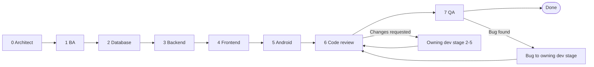

# Workflow rules

Every story moves through the stages in fixed order **0 → 1 → 2 → 3 → 4 → 5 → 6 → 7**. One agent owns each stage.



## 1. Stages
| # | Stage | Agent | Entry | Exit (must exist before handing off) |
|---|---|---|---|---|
| 0 | Architecture review | `project-architect` | Story status New | Impact analysis, affected layers, stage plan (which stages 2–5 apply), ADR if a decision was made |
| 1 | Analysis | `business-analyst` | Stage 0 done | Story complete from template, acceptance criteria in Given/When/Then, one task file per applicable stage |
| 2 | Database | `database-architect` | Stage 1 done | Entities, configuration, migration, seed data, DB tests; or "N/A" |
| 3 | Backend | `backend-developer` | Stage 2 done or N/A | Use cases, endpoints, SignalR events, unit + integration tests green |
| 4 | Frontend | `frontend-developer` | Stage 3 done or N/A | Screens, translations (en; other shipped languages per rules §7), RTL-safe CSS, component tests green |
| 5 | Android | `android-developer` | Stage 4 done or N/A | App changes, strings (en; other shipped languages per rules §7), unit tests, build green |
| 6 | Code review | `code-reviewer` | All dev stages done | Review report: Approved, or Changes requested with "Must fix" list |
| 7 | QA | `qa-tester` | Stage 6 Approved | Test cases, results per acceptance criterion, bugs logged, sign-off |

## 2. Status values
`New` → `Architecture` → `Analysis` → `Database` → `Backend` → `Frontend` → `Android` → `Code Review` → `QA` → `Done`, plus `Blocked` at any point.
The status always equals the stage currently working on it.

## 3. Rules for every stage
1. **Read first:** the work item, its parent story, the relevant spec sections, and the handoff notes of all earlier stages.
2. **Stay in your lane:** only change files your stage owns (see each agent). Need something from an earlier stage? Set `Blocked`, write the request under "Open questions" naming the stage, and stop.
3. **Never skip a stage.** A stage that does not apply is still recorded: the architect marks it N/A in the stage plan, and that stage's handoff says `N/A — <reason>`.
4. **Hand off in writing.** Append to the story's "Stage log" using the handoff format below, then set the status to the next stage.
5. **One stage per agent run.** Do not continue into the next stage's work.
6. **Spec conflicts stop the line.** If the story conflicts with `docs/PROJECT_SPEC.md`, set `Blocked` and ask the user; never decide silently.

## 4. Handoff format (append to the story's Stage log)
```
### Stage <n> — <stage name> — <agent> — <YYYY-MM-DD>
Result: Done | N/A | Blocked
Changed: <files or "none">
Notes for next stage: <what they need to know>
Open questions: <none | list>
```

## 5. Loops
- **Code review → Changes requested:** each "Must fix" names the owning stage (2–5). That stage fixes it, logs a handoff, and the story returns to stage 6. Only "Must fix" items block; "Should fix" and "Nice to have" become follow-up tasks if not done.
- **QA → failure:** QA creates a bug from `docs/templates/bug.md`, links it to the story, and assigns the owning stage. The fix goes through stage 6 again, then back to QA for retest.
- **Max 3 loops** per story; after that, stop and ask the user.

## 6. Bug workflow (bugs found outside a story)
`New` → stage 0 (architect: triage, severity check, owning stage) → owning dev stage (2–5) → stage 6 review → stage 7 retest → `Done`. Stage 1 (BA) joins only when the bug reveals a missing or unclear requirement.

## 7. Tasks
Tasks are created by the BA (stage 1), one per applicable stage, from `docs/templates/task.md`. A task belongs to exactly one story and one stage. The stage agent updates the task status and links it in the story's handoff.

## 8. File locations and IDs
- Stories: `docs/work/stories/STORY-###-short-name.md`
- Tasks: `docs/work/tasks/TASK-###-short-name.md`
- Bugs: `docs/work/bugs/BUG-###-short-name.md`
- ADRs: `docs/adr/ADR-###-short-name.md`
IDs are 3-digit, sequential per type; check the folder for the next free number.
